# System Architecture & Design Specification
## CookCircle - High-Performance Housing Society Cook Management Platform

---

### 1. High-Level Architecture Overview

CookCircle employs a modern, decoupled client-server architecture consisting of a Single Page Application (SPA) frontend in React.js and a modular Spring Boot 3 REST API backend connecting to a MySQL 8 relational database.

```mermaid
flowchart TD
    subgraph ClientLayer ["Client Presentation Layer (React.js + Tailwind CSS)"]
        UI_Guest["Public Website & Onboarding"]
        UI_Resident["Resident App & Live Tower Pool Visualizer"]
        UI_Cook["Cook Partner App (Vernacular EN/HI + OTP)"]
        UI_Admin["Society Admin & Backup Dispatch Console"]
        UI_Super["Super Admin Governance Platform"]
    end

    subgraph Gateway ["Transport & Security Gateway"]
        CORS["CORS Filter"]
        JWT_Filter["JWT Authentication & Claims Validator"]
        Tenant_Filter["Society Context & Multi-Tenant Resolver"]
    end

    subgraph BackendLayer ["Spring Boot 3.x Application Layer"]
        subgraph Controllers ["REST API Controllers"]
            AuthController["AuthController"]
            SocietyController["Society & Tower Controller"]
            CookController["Cook & Verification Controller"]
            SlotController["Slot & Pooling Engine Controller"]
            BookingController["Booking & OTP Controller"]
            LeaveController["Leave & Backup Dispatch Controller"]
            InvoiceController["Invoice & Razorpay Controller"]
            ReportController["Analytics & Audit Controller"]
        end

        subgraph Services ["Domain Service Layer"]
            PoolingService["Pooling & Conflict Prevention Service"]
            BackupDispatchService["Automated Standby Cook Matcher"]
            PaymentVerificationService["Razorpay HMAC-SHA256 Verifier"]
            NotificationService["In-App Alert Service"]
        end

        subgraph Repositories ["Spring Data JPA Repositories"]
            UserRepo["UserRepository"]
            SocietyRepo["SocietyRepository"]
            SlotRepo["CookingSlotRepository"]
            BookingRepo["BookingRepository"]
            InvoiceRepo["InvoiceRepository"]
            AuditRepo["AuditLogRepository"]
        end
    end

    subgraph DataLayer ["Data & External Integration Layer"]
        MySQL[("MySQL 8.0 Multi-Tenant Database")]
        RazorpayGateway["Razorpay Test Gateway (Payment Orders & Webhooks)"]
    end

    ClientLayer -->|HTTPS / JSON REST| Gateway
    Gateway --> Controllers
    Controllers --> Services
    Services --> Repositories
    Repositories --> MySQL
    Services --> RazorpayGateway
```



---

### 2. Architectural Design Patterns

1. **Layered Architecture (Controller-Service-Repository):**
   - Controllers handle HTTP transport, parameter validation (`@Valid`), and mapping to standard API responses.
   - Services implement critical transactional business logic (conflict prevention, automated backup cook matching, invoice calculations).
   - Repositories leverage Spring Data JPA with derived queries, `@Query` annotations, and custom specifications.

2. **Multi-Tenant Data Isolation Strategy:**
   - **Discriminator Column Pattern:** Records belonging to a society store a `society_id` foreign key.
   - Repository-level filtering ensures queries automatically scope to the authenticated user's `society_id`.
   - Super Admins bypass society filters; Society Admins, Residents, and Cooks are restricted to their authorized domain.

3. **Concurrency & Conflict Prevention Pattern:**
   - Booking a 45-minute cooking slot requires preventing simultaneous conflicting reservations.
   - Implemented via a combination of:
     - Unique database constraint: `UNIQUE KEY uk_slot_booking (slot_id, booking_date, status)`
     - Optimistic locking / Database transactions (`@Transactional(isolation = Isolation.REPEATABLE_READ)`)
     - Pre-commit re-verification before persisting `bookings`.

4. **Automated Standby Cook Dispatch Workflow:**
   ```mermaid
   sequenceDiagram
       autonumber
       actor Cook as Primary Cook
       participant Portal as CookCircle System
       actor Admin as Society Admin
       participant Standby as Backup Float Cook
       actor Resident as Tower Residents

       Cook->>Portal: Submit Leave Request (Date range: Tomorrow, Reason)
       Portal->>Admin: Alert: Pending Leave Request
       Admin->>Portal: Review & Click "Approve & Simulate Dispatch"
       Portal->>Portal: Find all affected active bookings for Tower B
       Portal->>Portal: Query available BACKUP_FLOAT_COOK (Zero conflicts)
       Portal->>Portal: Reassign slots to Standby Cook (Ramesh Kumar)
       Portal->>Standby: Dispatch Notification & Updated Route
       Portal->>Resident: Push Notification: "Backup Cook Assigned — Zero Meal Disruption"
       Portal->>Admin: Audit Log Recorded & MRR Safeguarded
   ```

5. **Payment Security & Verification Pattern:**
   - Client requests payment order creation (`POST /api/payments/orders`).
   - Server calls Razorpay API to generate `order_id` and registers a `PENDING` payment attempt.
   - Client executes Razorpay modal checkout and receives `razorpay_order_id`, `razorpay_payment_id`, and `razorpay_signature`.
   - Client sends credentials to server (`POST /api/payments/verify`).
   - Server calculates expected signature:
     $$\text{Signature} = \text{HMAC-SHA256}(\text{order\_id} + "|" + \text{payment\_id}, \text{razorpay\_secret})$$
   - Only on exact signature match is the invoice updated to `PAID` and receipt generated.

---

### 3. Frontend Architecture

- **State Management & Persistence:**
  - `AuthContext`: Authenticated user, role, token, society metadata.
  - `LanguageContext`: English / Hindi toggle with localized terminology dictionary.
  - `NotificationContext`: Live unread alert counter and toast messaging.
  - `localStorage` fallback persistence to allow seamless role toggling in the demo switcher while retaining slot reservations and simulated leave events.

- **Theme & Design Tokens:**
  - Dark SaaS Theme:
    - Base Background: `#0A0A0A`
    - Card Surface: `#151515`
    - Card Hover: `#1F1F1F`
    - Primary Accent (Emerald / Mint): `#10B981` / `#059669`
    - Secondary Accent (Indian Warm Saffron / Terracotta): `#EA580C` / `#F97316`
    - Border / Divider: `#262626`
    - Primary Text: `#FFFFFF`
    - Secondary Text: `#9CA3AF`

