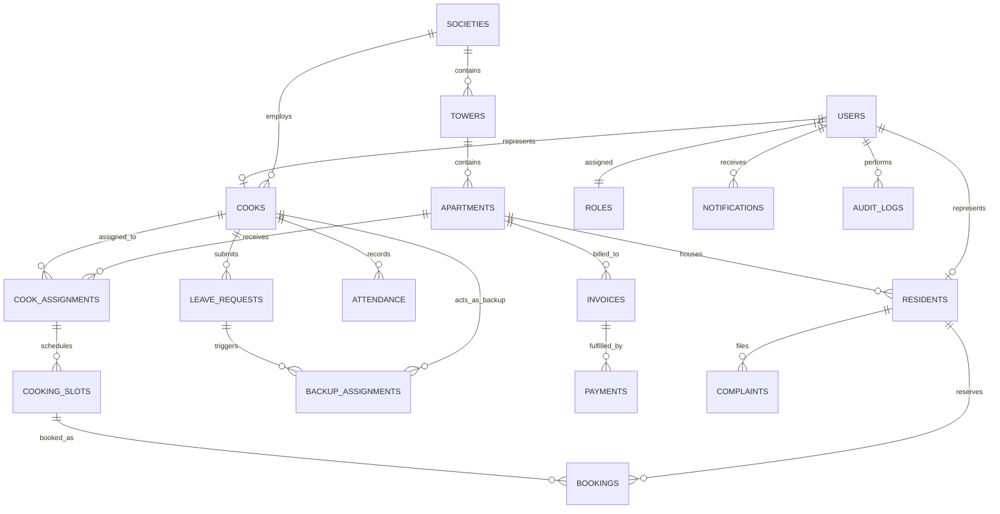

# Database Design & Relational Schema Specification
## CookCircle - Relational Model & Entity Specifications

---

### 1. Entity-Relationship Overview

The CookCircle database is designed for MySQL 8.0+. It strictly enforces relational integrity, foreign key constraints, indexes on high-frequency filters, and decimal arithmetic for currency fields.

---

### 2. Table Schemas & Data Dictionaries

#### 2.1 `roles`
System-wide user roles.
| Column | Type | Constraints | Description |
|---|---|---|---|
| `id` | BIGINT AUTO_INCREMENT | PK | Unique identifier |
| `name` | VARCHAR(50) | NOT NULL, UNIQUE | `ROLE_SUPER_ADMIN`, `ROLE_SOCIETY_ADMIN`, `ROLE_RESIDENT`, `ROLE_COOK` |
| `description` | VARCHAR(255) | NULL | Human readable role description |

#### 2.2 `users`
Global authentication table.
| Column | Type | Constraints | Description |
|---|---|---|---|
| `id` | BIGINT AUTO_INCREMENT | PK | Unique user ID |
| `email` | VARCHAR(120) | NOT NULL, UNIQUE | User login email |
| `phone` | VARCHAR(20) | NOT NULL, UNIQUE | Mobile contact number |
| `password_hash` | VARCHAR(255) | NOT NULL | BCrypt hashed password |
| `full_name` | VARCHAR(100) | NOT NULL | Display name |
| `role_id` | BIGINT | NOT NULL, FK(`roles.id`) | Foreign key to user role |
| `status` | ENUM('ACTIVE','INACTIVE','SUSPENDED') | DEFAULT 'ACTIVE' | Account state |
| `created_at` | DATETIME | DEFAULT CURRENT_TIMESTAMP | Registration timestamp |
| `updated_at` | DATETIME | DEFAULT CURRENT_TIMESTAMP ON UPDATE CURRENT_TIMESTAMP | Last update |

#### 2.3 `societies`
Multi-tenant housing societies.
| Column | Type | Constraints | Description |
|---|---|---|---|
| `id` | BIGINT AUTO_INCREMENT | PK | Society ID |
| `code` | VARCHAR(20) | NOT NULL, UNIQUE | Unique slug e.g. `HG-POWAI` |
| `name` | VARCHAR(150) | NOT NULL | e.g., "Hiranandani Gardens" |
| `address_line` | VARCHAR(255) | NOT NULL | Street address |
| `city` | VARCHAR(100) | NOT NULL | e.g., "Mumbai" |
| `state` | VARCHAR(100) | NOT NULL | e.g., "Maharashtra" |
| `postal_code` | VARCHAR(20) | NOT NULL | Postal code |
| `base_pooling_fee` | DECIMAL(10,2) | NOT NULL DEFAULT 4200.00 | Standard pooled cost/flat/mo |
| `skip_meal_credit` | DECIMAL(10,2) | NOT NULL DEFAULT 140.00 | Wallet credit per skipped slot |
| `status` | ENUM('ACTIVE','INACTIVE') | DEFAULT 'ACTIVE' | Operational status |
| `created_at` | DATETIME | DEFAULT CURRENT_TIMESTAMP | |
| `updated_at` | DATETIME | DEFAULT CURRENT_TIMESTAMP ON UPDATE CURRENT_TIMESTAMP | |

#### 2.4 `towers`
Buildings/wings within a society.
| Column | Type | Constraints | Description |
|---|---|---|---|
| `id` | BIGINT AUTO_INCREMENT | PK | Tower ID |
| `society_id` | BIGINT | NOT NULL, FK(`societies.id`) | Parent society |
| `name` | VARCHAR(50) | NOT NULL | e.g. "Tower B", "Wing 4" |
| `total_floors` | INT | NOT NULL DEFAULT 20 | Height in floors |
| `created_at` | DATETIME | DEFAULT CURRENT_TIMESTAMP | |

#### 2.5 `apartments`
Individual flats within a tower.
| Column | Type | Constraints | Description |
|---|---|---|---|
| `id` | BIGINT AUTO_INCREMENT | PK | Flat ID |
| `tower_id` | BIGINT | NOT NULL, FK(`towers.id`) | Parent tower |
| `flat_number` | VARCHAR(20) | NOT NULL | e.g. "402", "701", "904" |
| `floor_number` | INT | NOT NULL | Floor index |
| `configuration` | VARCHAR(20) | DEFAULT '2BHK' | Apartment layout (1BHK, 2BHK, 3BHK) |
| `status` | ENUM('OCCUPIED','VACANT') | DEFAULT 'OCCUPIED' | |
| `created_at` | DATETIME | DEFAULT CURRENT_TIMESTAMP | |
| UNIQUE KEY `uk_tower_flat` (`tower_id`, `flat_number`) |

#### 2.6 `residents`
Resident profile linked to apartment and user.
| Column | Type | Constraints | Description |
|---|---|---|---|
| `id` | BIGINT AUTO_INCREMENT | PK | Resident ID |
| `user_id` | BIGINT | NOT NULL, UNIQUE, FK(`users.id`) | Linked auth account |
| `society_id` | BIGINT | NOT NULL, FK(`societies.id`) | Society context |
| `apartment_id` | BIGINT | NOT NULL, FK(`apartments.id`) | Assigned flat |
| `household_size` | VARCHAR(20) | DEFAULT '3-4 members' | '1-2 members' or '3-4 members' |
| `dietary_pref` | VARCHAR(30) | DEFAULT 'Vegetarian' | 'Vegetarian', 'Non-Vegetarian', 'Jain' |
| `wallet_balance`| DECIMAL(10,2) | DEFAULT 0.00 | Accumulated skip credits |
| `created_at` | DATETIME | DEFAULT CURRENT_TIMESTAMP | |

#### 2.7 `cooks`
Cook partners (Primary and Standby/Float).
| Column | Type | Constraints | Description |
|---|---|---|---|
| `id` | BIGINT AUTO_INCREMENT | PK | Cook ID |
| `user_id` | BIGINT | NOT NULL, UNIQUE, FK(`users.id`) | User credentials |
| `society_id` | BIGINT | NOT NULL, FK(`societies.id`) | Assigned society |
| `type` | ENUM('PRIMARY_COOK','BACKUP_FLOAT_COOK') | NOT NULL | Shift status |
| `rating` | DECIMAL(3,2) | DEFAULT 4.90 | Cook performance rating |
| `specialties` | VARCHAR(255) | NOT NULL | "North Indian, Gujarati, Jain" |
| `experience_years` | INT | NOT NULL DEFAULT 5 | Culinary experience |
| `aadhaar_verified` | BOOLEAN | DEFAULT TRUE | Verification status |
| `police_verified` | BOOLEAN | DEFAULT TRUE | Background check badge |
| `vaccination_status`| VARCHAR(50) | DEFAULT 'Double Vaccinated' | Health compliance |
| `status` | ENUM('ACTIVE','ON_LEAVE','INACTIVE') | DEFAULT 'ACTIVE' | Operational status |
| `created_at` | DATETIME | DEFAULT CURRENT_TIMESTAMP | |

#### 2.8 `cook_assignments`
Long-term mapping of cooks to specific towers or shifts.
| Column | Type | Constraints | Description |
|---|---|---|---|
| `id` | BIGINT AUTO_INCREMENT | PK | |
| `cook_id` | BIGINT | NOT NULL, FK(`cooks.id`) | Assigned cook |
| `tower_id` | BIGINT | NOT NULL, FK(`towers.id`) | Assigned tower |
| `shift` | ENUM('MORNING','EVENING','BOTH') | NOT NULL | Assigned shift |
| `start_date` | DATE | NOT NULL | Assignment start |
| `end_date` | DATE | NULL | Assignment end |
| `status` | ENUM('ACTIVE','INACTIVE') | DEFAULT 'ACTIVE' | |

#### 2.9 `cooking_slots`
Available 45-minute booking windows within a tower.
| Column | Type | Constraints | Description |
|---|---|---|---|
| `id` | BIGINT AUTO_INCREMENT | PK | |
| `tower_id` | BIGINT | NOT NULL, FK(`towers.id`) | Tower location |
| `shift` | ENUM('MORNING','EVENING') | NOT NULL | Session window |
| `slot_order` | INT | NOT NULL | Sequence (1 to 5) |
| `start_time` | TIME | NOT NULL | e.g. 06:30:00 |
| `end_time` | TIME | NOT NULL | e.g. 07:15:00 |
| `is_active` | BOOLEAN | DEFAULT TRUE | Availability switch |
| UNIQUE KEY `uk_tower_slot` (`tower_id`, `shift`, `slot_order`) |

#### 2.10 `bookings`
Resident slot reservations.
| Column | Type | Constraints | Description |
|---|---|---|---|
| `id` | BIGINT AUTO_INCREMENT | PK | |
| `society_id` | BIGINT | NOT NULL, FK(`societies.id`) | Society isolation |
| `slot_id` | BIGINT | NOT NULL, FK(`cooking_slots.id`) | Slot reference |
| `apartment_id`| BIGINT | NOT NULL, FK(`apartments.id`) | Flat reserving slot |
| `resident_id` | BIGINT | NOT NULL, FK(`residents.id`) | Resident who booked |
| `primary_cook_id`| BIGINT | NOT NULL, FK(`cooks.id`) | Primary assigned cook |
| `effective_cook_id`| BIGINT | NOT NULL, FK(`cooks.id`)| Cook serving today |
| `booking_date`| DATE | NOT NULL | Reservation date |
| `dishes_planned`| TEXT | NULL | e.g. "Dal Tadka, Aloo Gobi" |
| `arrival_otp` | VARCHAR(6) | NOT NULL | 4-digit check-in OTP |
| `status` | ENUM('CONFIRMED','COOKING','COMPLETED','SKIPPED','CANCELLED') | DEFAULT 'CONFIRMED' | |
| `skip_refund_amount`| DECIMAL(10,2) | DEFAULT 0.00 | Refunded wallet amount |
| `created_at` | DATETIME | DEFAULT CURRENT_TIMESTAMP | |
| UNIQUE KEY `uk_slot_date` (`slot_id`, `booking_date`, `status`) |

#### 2.11 `attendance`
Daily cook arrival and session completion logs.
| Column | Type | Constraints | Description |
|---|---|---|---|
| `id` | BIGINT AUTO_INCREMENT | PK | |
| `cook_id` | BIGINT | NOT NULL, FK(`cooks.id`) | Attending cook |
| `booking_id` | BIGINT | NOT NULL, FK(`bookings.id`) | Linked flat session |
| `date` | DATE | NOT NULL | Execution date |
| `check_in_time`| DATETIME | NULL | Timestamp OTP verified |
| `check_out_time`| DATETIME | NULL | Timestamp cooking marked done |
| `status` | ENUM('ON_TIME','DELAYED','ABSENT') | DEFAULT 'ON_TIME' | Attendance verdict |
| `remarks` | VARCHAR(255) | NULL | Additional notes |

#### 2.12 `leave_requests`
Cook leave applications.
| Column | Type | Constraints | Description |
|---|---|---|---|
| `id` | BIGINT AUTO_INCREMENT | PK | |
| `cook_id` | BIGINT | NOT NULL, FK(`cooks.id`) | Requesting cook |
| `start_date` | DATE | NOT NULL | Leave start |
| `end_date` | DATE | NOT NULL | Leave end |
| `reason` | VARCHAR(255) | NOT NULL | e.g. "Family wedding" |
| `status` | ENUM('PENDING','APPROVED','REJECTED') | DEFAULT 'PENDING' | Status |
| `action_by` | BIGINT | NULL, FK(`users.id`) | Admin who approved |
| `action_notes`| VARCHAR(255) | NULL | Notes |
| `created_at` | DATETIME | DEFAULT CURRENT_TIMESTAMP | |

#### 2.13 `backup_assignments`
Dispatched standby cook coverage for approved leaves.
| Column | Type | Constraints | Description |
|---|---|---|---|
| `id` | BIGINT AUTO_INCREMENT | PK | |
| `leave_request_id`| BIGINT | NOT NULL, FK(`leave_requests.id`) | Associated leave |
| `primary_cook_id`| BIGINT | NOT NULL, FK(`cooks.id`) | On-leave cook |
| `backup_cook_id` | BIGINT | NOT NULL, FK(`cooks.id`) | Standby float cook |
| `tower_id` | BIGINT | NOT NULL, FK(`towers.id`) | Tower covered |
| `date` | DATE | NOT NULL | Date of replacement |
| `status` | ENUM('ACTIVE','COMPLETED','CANCELLED') | DEFAULT 'ACTIVE' | |
| `assigned_by` | BIGINT | NOT NULL, FK(`users.id`) | Admin user ID |
| `created_at` | DATETIME | DEFAULT CURRENT_TIMESTAMP | |

#### 2.14 `invoices`
Monthly society cooking service bills.
| Column | Type | Constraints | Description |
|---|---|---|---|
| `id` | BIGINT AUTO_INCREMENT | PK | |
| `invoice_number` | VARCHAR(50) | NOT NULL, UNIQUE | e.g. `INV-2026-11-HG-402` |
| `society_id` | BIGINT | NOT NULL, FK(`societies.id`) | |
| `apartment_id`| BIGINT | NOT NULL, FK(`apartments.id`) | Billed flat |
| `resident_id` | BIGINT | NOT NULL, FK(`residents.id`) | Billed resident |
| `billing_month`| VARCHAR(7) | NOT NULL | e.g. "2026-11" |
| `base_amount` | DECIMAL(10,2) | NOT NULL | e.g. 4200.00 |
| `discount_wallet`| DECIMAL(10,2) | DEFAULT 0.00 | Deduction from skip credits |
| `net_amount` | DECIMAL(10,2) | NOT NULL | Payable amount |
| `status` | ENUM('UNPAID','PAID','OVERDUE','CANCELLED') | DEFAULT 'UNPAID' | |
| `due_date` | DATE | NOT NULL | Due date |
| `paid_at` | DATETIME | NULL | Settlement timestamp |
| `created_at` | DATETIME | DEFAULT CURRENT_TIMESTAMP | |

#### 2.15 `payments`
Transaction attempts and Razorpay records.
| Column | Type | Constraints | Description |
|---|---|---|---|
| `id` | BIGINT AUTO_INCREMENT | PK | |
| `invoice_id` | BIGINT | NOT NULL, FK(`invoices.id`) | Linked invoice |
| `razorpay_order_id`| VARCHAR(100) | NOT NULL, UNIQUE | Razorpay Order ID |
| `razorpay_payment_id`| VARCHAR(100) | NULL | Razorpay Payment ID |
| `razorpay_signature`| VARCHAR(255) | NULL | Server verified HMAC |
| `amount` | DECIMAL(10,2) | NOT NULL | Paid amount |
| `method` | VARCHAR(50) | DEFAULT 'RAZORPAY_TEST' | UPI, CARD, NETBANKING, CASH |
| `status` | ENUM('PENDING','SUCCESS','FAILED') | DEFAULT 'PENDING' | Transaction state |
| `verified_at` | DATETIME | NULL | Timestamp verified |

#### 2.16 `notifications`
In-app user alerts.
| Column | Type | Constraints | Description |
|---|---|---|---|
| `id` | BIGINT AUTO_INCREMENT | PK | |
| `user_id` | BIGINT | NOT NULL, FK(`users.id`) | Recipient |
| `title` | VARCHAR(120) | NOT NULL | Headline |
| `message` | TEXT | NOT NULL | Notification body |
| `type` | VARCHAR(50) | NOT NULL | `SLOT_BOOKED`, `BACKUP_DISPATCHED`, `OTP_READY` |
| `is_read` | BOOLEAN | DEFAULT FALSE | Read state |
| `created_at` | DATETIME | DEFAULT CURRENT_TIMESTAMP | |

#### 2.17 `complaints`
Resident feedback and dispute tickets.
| Column | Type | Constraints | Description |
|---|---|---|---|
| `id` | BIGINT AUTO_INCREMENT | PK | |
| `resident_id` | BIGINT | NOT NULL, FK(`residents.id`) | Submitting resident |
| `category` | VARCHAR(50) | NOT NULL | 'Hygiene', 'Punctuality', 'Taste', 'Billing' |
| `description` | TEXT | NOT NULL | Detailed issue |
| `status` | ENUM('OPEN','IN_PROGRESS','RESOLVED') | DEFAULT 'OPEN' | Ticket progress |
| `resolution_notes`| TEXT | NULL | Admin comments |
| `created_at` | DATETIME | DEFAULT CURRENT_TIMESTAMP | |

#### 2.18 `audit_logs`
Administrative trace and security log.
| Column | Type | Constraints | Description |
|---|---|---|---|
| `id` | BIGINT AUTO_INCREMENT | PK | |
| `actor_user_id`| BIGINT | NOT NULL, FK(`users.id`) | Who executed action |
| `action` | VARCHAR(100) | NOT NULL | e.g. `SIMULATE_BACKUP_DISPATCH` |
| `entity_type` | VARCHAR(50) | NOT NULL | e.g. `LEAVE_REQUEST`, `PAYMENT` |
| `entity_id` | BIGINT | NOT NULL | Primary key of target |
| `details` | JSON | NULL | Contextual metadata |
| `created_at` | DATETIME | DEFAULT CURRENT_TIMESTAMP | Timestamp |

